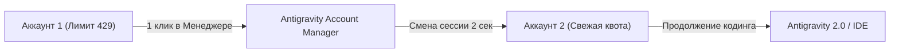

# 🚀 Antigravity Account Manager
### Мгновенная ротация Google-аккаунтов и обход суточных лимитов в Antigravity 2.0 & IDE

---

**Закончились лимиты Google Gemini (429 Resource Exhausted)?**  
Не ждите 24 часа сброса квоты — переключайтесь на запасные аккаунты в один клик без потери истории диалогов, открытых файлов и рабочего контекста!

[📥 **Скачать Antigravity Manager (v1.0.0)**](https://github.com/Fluxess/antigravity-account-manager/releases/latest) • [🛒 **Купить ключ доступа**](#-тарифы-и-покупка-ключа)

---

## ⚡ В чём проблема?

При активной разработке в **Antigravity 2.0** или **Antigravity IDE** мощные модели (Gemini 2.5 Pro / Flash) быстро упираются в квоты Google Cloud / Google AI Studio:
* Вы получаете ошибку `429: Resource Exhausted` прямо посреди написания сложного модуля.
* Стандартный выход из аккаунта и ручной вход через браузер сбрасывает сессию, кэш и требует постоянного ввода логинов и подтверждений по SMS.

## 💡 Решение

**Antigravity Account Manager** решает эту проблему за 2 секунды:
1. Вы один раз привязываете 2, 3 или более Google-аккаунтов (личный, рабочий, аккаунты с Google One AI Premium).
2. Как только на одном аккаунте квота исчерпана — нажимаете **«⚡ Переключить»**.
3. Приложение сохраняет ваши куки, подставляет запасной профиль и перезапускает Antigravity.
4. **Ваш проект, открытые файлы и история чата остаются нетронутыми!** Меняется только активная квота Google.

---

## ✨ Ключевые возможности

- 🔄 **Hot-Swap в 1 клик:** Бесшовное переключение между аккаунтами без ввода паролей.
- ✉️ **Автоопределение активного профиля:** Программа сама видит email текущей сессии.
- 🛡️ **Safe Rollback (Безопасность):** Автоматический бэкап перед каждой сменой сессии — данные никогда не потеряются.
- 🏷️ **Статусы квот:** Наглядные бейджи `🟢 ГОТОВ`, `🔴 ИСЧЕРПАН`, `🔵 AI PREMIUM` и заметки со временем сброса.
- 🪟 **Полная автономность:** Скомпилированное Windows-приложение, не требует установки Python, Git или Node.js.

---

## 💰 Тарифы и покупка ключа

| Тариф | Срок действия | Стоимость | Кому подходит |
|:---:|:---:|:---:|:---|
| **Тестовый** | **3 Дня** | **69 ₽** | Попробовать в бою и завершить срочный таск |
| **Недельный** | **1 Неделя** | **119 ₽** | На время спринта или активного хакатона |
| **Месячный** | **1 Месяц** | **149 ₽** | 💥 **Хит продаж!** Для постоянной комфортной работы |
| **Годовой** | **1 Год** | **399 ₽** | Максимальная выгода (всего 33 ₽ в месяц) |

### 🛒 Как приобрести ключ:
* **Telegram:** [@ваш_контакт](https://t.me/) *(напишите менеджеру для моментальной оплаты картой/СБП/криптой)*
* **Автовыдача на маркетплейсах:** [FunPay / Plati.market](https://funpay.com/) *(мгновенное получение ключа сразу после оплаты)*

---

## 🚀 Быстрый старт (Инструкция)

1. **Скачайте программу:** Перейдите во вкладку [Releases](https://github.com/Fluxess/antigravity-account-manager/releases/latest) и скачайте архив `AntigravityManager-v1.0.0.zip`.
2. **Распакуйте и запустите:** Запустите `AntigravityManager.exe`.
3. **Активируйте ключ:** Вставьте полученный лицензионный ключ в поле активации и нажмите **«АКТИВИРОВАТЬ ДОСТУП»**.
4. **Сохраните профили:**
   - Откройте Antigravity с вашим первым аккаунтом -> нажмите в менеджере **«💾 Сохранить как профиль»** (например, `Основной`).
   - Нажмите **«➕ Добавить новый аккаунт»** -> войдите во второй Google-аккаунт в окне Antigravity -> нажмите **«💾 Сохранить как профиль»** (например, `Запасной 2`).
5. **Готово!** Теперь при исчерпании лимитов просто нажимайте **«⚡ Переключить»**.

---

## ❓ Часто задаваемые вопросы (FAQ)

<b>Безопасно ли это? Передаются ли куда-то мои пароли?</b>

<b>Абсолютно безопасно.</b> Программа работает строго локально на вашем компьютере. Она не сохраняет ваши пароли и не отправляет данные на сторонние серверы. Менеджер лишь изолирует локальные файлы сессии Chromium (AppData) по аналогии с профилями Google Chrome.

<b>Windows SmartScreen пишет: «Система Windows защитила ваш компьютер». Что делать?</b>

Это стандартное предупреждение Windows для всех новых независимых программ без платного корпоративного сертификата Microsoft (который стоит от $300/год). Нажмите <b>«Подробнее»</b> ➔ <b>«Выполнить в любом случае»</b>.

<b>Что произойдет, если Antigravity обновится?</b>

Архитектура хранения сессий Antigravity стандартна для всех приложений на базе Chromium/Electron. При обновлении программы все ваши профили продолжат корректно работать.

<b>Можно ли перенести лицензию на другой компьютер?</b>

Лицензионный ключ при первой активации аппаратно привязывается к вашему ПК (Hardware ID). Если вам требуется перенос лицензии при смене компьютера — напишите в поддержку.

---

## ⚖️ Правовая информация (Disclaimer)

*Google Antigravity is a trademark of Google LLC.*  
Данная утилита является независимым сторонним инструментом для управления локальными пользовательскими профилями и не связана, не спонсируется и не аффилирована с компанией Google LLC.
